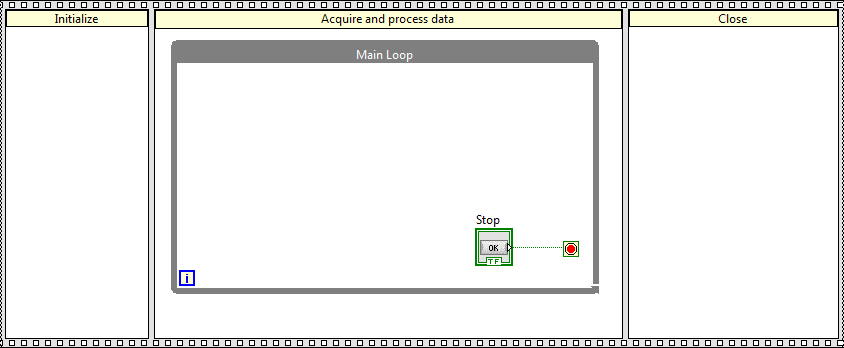

# NI ARC Manual Control - LabVIEW myRIO Project

A LabVIEW project designed for manual robot control and joystick integration using **NI myRIO** (ARM Linux Real-Time target).



---

## 📋 Software & Hardware Requirements

### Software & Drivers
* **LabVIEW**: LabVIEW 2021 (21.0) 64-bit or 32-bit
* **LabVIEW Modules & Toolkits**:
  * LabVIEW Real-Time Module
  * LabVIEW myRIO Software / Toolkit (v1.0 / v1.1)
  * RioEmbeddedCAN Toolkit

### Hardware
* **NI myRIO-1900** (or NI ELVIS III)
* **USB Joystick / Controller**

---

## 📁 Project Structure

```text
NI ARC/
├── Manual Control.lvproj           # Main LabVIEW Project File
├── Main.vi                         # Main Application Entry VI (Runs on myRIO Target)
├── Joystick/                       # Joystick Configuration & Library
│   ├── Joystick Configuration.vi
│   └── Untitled Library 2.lvlib
├── Untitled 2.vi                   # SubVI / Component
├── Untitled 4.vi                   # SubVI / Component
└── documentation/                  # Documentation & Architecture Diagrams
    ├── myRIO Project Documentation.html
    └── myRIO_Project_Diagram.gif
```

---

## 🚀 How to Run the Project

1. **Connect Hardware**: Connect your NI myRIO target to your computer via USB or Ethernet.
2. **Open Project**: Double-click `Manual Control.lvproj` to open the project in LabVIEW.
3. **Configure Target IP**:
   * Expand the `MyRIO-SooYewGuan` target node in the Project Explorer.
   * Right-click the target $\rightarrow$ **Properties** $\rightarrow$ Update the **IP Address / Name** to match your myRIO device.
4. **Deploy & Run**:
   * Open `Main.vi` under the myRIO target.
   * Click the **Run** arrow (LabVIEW will deploy dependencies and execute on the myRIO target).

---

## ⚙️ Recommended LabVIEW Git Configuration

To ensure clean version control with LabVIEW binary VIs:
1. Open LabVIEW.
2. Go to **Tools** $\rightarrow$ **Options** $\rightarrow$ **Environment**.
3. Enable **"Separate compiled code from source files for new files"**.

---

## 📜 License

Distributed under the MIT License. See `LICENSE` for more information.
